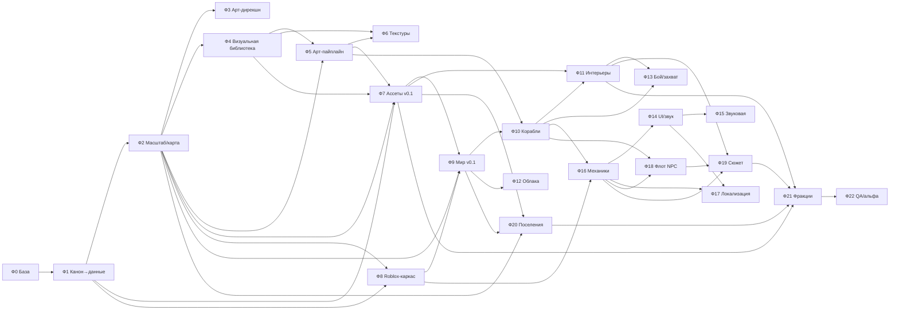

# THREE HORIZONS — ROADMAP 0.1

> **Версия базы:** 0.1 (чистый старт) · **Дата:** 2026-11-10 · **Основа:** `docs/` (канон) + Bible
> **Статус:** план. Код, ассеты, тулинг создаются с нуля; старые наработки в `../_TRASH_2026-11-10/` не восстанавливаем.

Этот файл — точка входа. Здесь: как читать роадмап, карта фаз, порядок работ, открытые решения,
гейты качества и грабли, которые уже поймали в прошлой жизни проекта. Детали каждого шага — в
файлах фаз: `docs/roadmap/phase-00-baza.md` … `phase-11-qa-alpha.md`.

---

## 1. Как пользоваться

1. **Перед любой работой** откройте фазу и её шаг. В каждом шаге есть: что сделать, чем, что должно
   получиться и критерий «готово». Пока критерий не выполнен — шаг не закрыт.
2. **Шаг = атомарная единица.** Один шаг — один коммит (или один коммит на 2–3 шага, если они
   мелкие). В сообщении коммита — номер шага: `Ф4.2: базовый набор домов Арквейна`.
3. **После фазы** — прогон гейтов (раздел 5), запись в `docs/CHANGELOG.md`, бэкап, обновление
   `docs/PROJECT_STATUS.md` (переименуем в `STATUS.md` в Ф0).
4. **Канон не правим молча.** Любое отступление от `docs/` — сначала запись в `docs/DECISIONS.md`
   (ID, основание, статус), потом работа. Иначе через месяц снова будет «а как правильно?».
5. **Не строим «всё сразу».** Каждая фаза даёт работающий срез: игру можно запустить и посмотреть.

## 2. Принципы нового старта

- **Сначала данные, потом картинка.** Все правила (фракции, товары, цены, корабли) живут в
  `GAME_DESIGN/` как чистые JSON/Luau-таблицы без Roblox-зависимостей. Roblox — адаптер.
- **Игра не зависит от уровня арта.** Нет меша → фолбэк на боксы (`MeshBuilding` → `Builder`).
  Поэтому геймплей можно проверять, пока художник/пайплайн ещё не готов.
- **Один источник истины на систему.** Масштаб, токены, координаты, цены — по одному файлу.
  Дубли цифр в двух документах = баг документации.
- **Каждый шаг проверяем.** Никаких «сделали, вроде работает»: критерий «готово» — это команда,
  скриншот, цифра из Output или тест.
- **Малые поставки.** v0.1 — это один район одной столицы, один корабль, один товарный цикл и
  один квест. Всё остальное — после того, как это работает.

## 3. Карта фаз

| № | Фаза | Цель | Зависит от | Выход (артефакт) | Шагов | Сессий |
|---|---|---|---|---|---|---|
| **Ф00** | [База и правила](docs/roadmap/phase-00-baza.md) | пустой, но полностью рабочий скелет проекта: структура папок, инструменты, гейты, | — | репозиторий + `preflight` + записанные решения S-01…S-06 | 12 | 1–2 |
| **Ф01** | [Канон → данные](docs/roadmap/phase-01-canon-to-data.md) | перевести весь лор из `docs/` в машиночитаемые таблицы без Roblox-зависимостей. | Ф0 | `GAME_DESIGN/*.json` + валидатор + `bundle.json` | 13 | 2 |
| **Ф02** | [Масштаб и геометрия мира](docs/roadmap/phase-02-world-geometry.md) | одна система мер и координат, по которой можно строить и город, и корабль, и небо. | Ф1 | `constants.json`, `WORLD_COORDINATES.csv`, карта PNG/SVG, `travel_times.json` | 10 | 1–2 |
| **Ф03** | [Арт-дирекшн и стиль](docs/roadmap/phase-03-art-direction.md) | превратить стиль из прозы в данные, которые проверяются. Сейчас канон разбросан: | Ф2 (масштаб) | `GAME_DESIGN/Style.json` + `docs/STYLE_BIBLE.md` + gate A-1 стиля | 8 | 2 |
| **Ф04** | [Визуальная библиотека (рендеры-эталоны)](docs/roadmap/phase-04-visual-library.md) | Рендер-эталон каждой модели игры — от пылинки 0.1 м до острова 1200×900 м. Чтобы по нему моделировали, а не по вкусовщине: эталон показывает реальный масштаб, пропорции и силуэт. Масштаб берётся из Ф2, палитры — из DESIGN_TOKENS. | Ф2 (масштаб, карта) | реестр классов `blender/visual_library.json` + ~52 рендера + 9 контактных листов | 10 | 2 |
| **Ф05** | [Арт-пайплайн (Blender → FBX → Roblox)](docs/roadmap/phase-05-art-pipeline.md) | воспроизводимый конвейер: скрипт в Blender → правильный FBX → проверка → импорт в Studio | Ф4 (визуальная библиотека), Ф2 (масштаб) |  | 12 | ? |
| **Ф06** | [Текстурная библиотека (23 материала)](docs/roadmap/phase-06-texture-library.md) | Все 23 материала канона с полным набором карт (albedo/normal/roughness), бесшовные и строго в палитре DESIGN_TOKENS. Сейчас в плане 3 материала — остальные 20 нечем красить. | Ф4 (визуальная библиотека), Ф5 (арт-пайплайн) | 69 PNG (23×3) + `blender/textures/manifest.json` с HEX и тайлингом | 8 | 3 |
| **Ф07** | [Ассеты v0.1](docs/roadmap/phase-07-assets.md) | минимальный, но законченный ассет-пак, которого хватит на первый квартал столицы и один | Ф5 (арт-пайплайн), Ф4 (визуальная библиотека), Ф2 (масштаб), Ф1 (данные) |  | 14 | ? |
| **Ф08** | [Roblox-каркас v0.1](docs/roadmap/phase-08-roblox-skeleton.md) | собираемый Rojo-проект с деревом модулей, конфигами из данных, сетью, сохранениями и | Ф1 (данные), Ф2 (масштаб) |  | 12 | ? |
| **Ф09** | [Мир v0.1](docs/roadmap/phase-09-world.md) | один остров, один квартал столицы Арквейна, вода под островом, спавн и стриминг. | Ф2, Ф7 (ассеты), Ф8 |  | 12 | ? |
| **Ф10** | [Корабли v0.1](docs/roadmap/phase-10-ships.md) | один средний корпус, который стоит на воде у причала, слушается управления и везёт игрока | Ф9, Ф5 |  | 12 | ? |
| **Ф11** | [Интерьеры (помещения корабля и зданий)](docs/roadmap/phase-11-interiors.md) | Интерьер корабля — обязателен по Bible §4: рубка, каюта капитана, машинное, трюм, кубрик, оружейная. Плюс помещения зданий: дом, таверна, мастерская, склад, торговая контора. Сейчас в плане — «болванка», то есть пусто. | Ф10 (корабли), Ф7 (ассеты) |  | 8 | ? |
| **Ф12** | [Облака и облачное море v0.1](docs/roadmap/phase-12-clouds.md) | живое облачное море и погода, которые видно и которые влияют на игру. Без мешей — | Ф9 (мир) |  | 12 | ? |
| **Ф13** | [Бой, абордаж, захват корабля](docs/roadmap/phase-13-combat-capture.md) | Захват со сменой владельца — ядро жанра, а не «потом». Ф10 обещал отдельную фазу: вот она. Огонь, абордаж, потеря части груза, уничтожение при критическом уроне, защита от повторной атаки. Всё по Bible §4, §6, §8. | Ф10 (корабли), Ф11 (интерьеры) | боевой контур корабля: орудийные точки, урон, абордаж, захват, последствия | 9 | 3 |
| **Ф14** | [UI и звук v0.1](docs/roadmap/phase-14-ui-audio.md) | игра выглядит и звучит как Three Horizons, а не как тестовая сцена: единый стиль | Ф16 |  | 12 | ? |
| **Ф15** | [Звуковая библиотека (полный набор)](docs/roadmap/phase-15-sound-library.md) | Полный набор звуков по зонам (порт, рынок, мастерская, таверна, море, лес, каюта), погодные слои и 3 музыкальные темы. Ф14 делает 12–15 SFX на срез v0.1 — на полный мир нужен свой системный обход. | Ф14 (UI и звук v0.1) | `blender/sounds/manifest.json` + ~50 звуков + 3 музыкальные темы | 8 | 3 |
| **Ф16** | [Механики v0.1 (экономика, NPC, квест)](docs/roadmap/phase-16-mechanics.md) | один полный игровой цикл: выбрал фракцию/героя → пришёл в город → взял квест → купил | Ф8, Ф10, Ф10 |  | 15 | ? |
| **Ф17** | [Локализация RU/EN](docs/roadmap/phase-17-localization.md) | Все игровые строки — в одной таблице с переводом на английский. Roblox — международная площадка: без EN игра не выходит за пределы СНГ. Плюс это запрещает вшивать текст в код: строка в коде — это строка, которую не переведёшь. | Ф14 (UI и звук), Ф16 (механики) | `GAME_DESIGN/Strings.json` + локализация всех UI, квестов, товаров, подсказок, ошибок | 7 | 2 |
| **Ф18** | [Флот NPC и офлайн-симуляция](docs/roadmap/phase-18-npc-fleet.md) | Мир не должен быть пустым между игроками: NPC-капитаны возят грузы по маршрутам, сервер считает их офлайн тиками (5 мин, кап 24 ч) вместо вечной физики каждого. Плюс общие события: одно пиратское нападение — одно на всех рядом, без копий (Bible §7). | Ф10 (корабли), Ф16 (механики) | NPC-флот с офлайн-симуляцией + общие события для всех рядом | 8 | 3 |
| **Ф19** | [Сюжет: заговор трёх домов](docs/roadmap/phase-19-story-three-houses.md) | Цепочка квестов по Bible §3: все трое героев прибывают в Эстерхольм, их крючки срабатывают (пропавший отец, потерянный груз, налоги землевладельца), расследование выводит на Валькрофта, Сольвейна и Рейвенхолла. Без древнего зла — только люди и деньги (C-08). | Ф16 (механики), Ф18 (флот NPC), Ф11 (интерьеры) | сюжетная цепочка квестов + 3 NPC-антигониста + 2 финала | 8 | 4 |
| **Ф20** | [Малые поселения и POI](docs/roadmap/phase-20-settlements.md) | 7 названных поселений (Бронзовый Холм, Фарнвик, Редстоун, Вестпорт, Зелёная Долина, Ривервуд, Солнечная Ферма) плюс обломки, стоянки, укрытия — это и есть «мир, где есть чем заняться» между столицами. Сейчас в роадмапе нет ни слова про них. | Ф9 (мир v0.1), Ф7 (ассеты v0.1), Ф2 (карта) | `GAME_DESIGN/Settlements.json` + постройки на карте + 4 мини-острова из Ф2 | 8 | 3 |
| **Ф21** | [Вторая и третья фракция (полный объём)](docs/roadmap/phase-21-factions-full.md) | v0.1 — только Арквейн. Нужны полноценные Вальмер и Гринвальд: столицы, районы, ресурс, производство, специализации, NPC-торговцы, свои квесты, палитра. Иначе игра про одного острова, а Bible обещает три (Bible §2). | Ф7 (ассеты), Ф19 (сюжет), Ф20 (поселения), Ф11 (интерьеры) | 2 столицы, 16 районов, 2 ресурса, 8 специализаций, квесты, палитры | 10 | 5 |
| **Ф22** | [QA, оптимизация, альфа](docs/roadmap/phase-22-qa-alpha.md) | доказать цифрами, что v0.1 играбельна: гейты закрыты, бюджеты соблюдены, сохранения | Ф21 (вторая и третья фракция) |  | 11 | ? |

**Итого:** 23 фазы, 239 шагов.

Фазы 0–2 — фундамент (правила, данные, геометрия). Фазы 3–7 — арт-конвейер
(арт-дирекшн и стиль → визуальная библиотека → пайплайн → текстуры → ассеты).
Фазы 8–13 — мир, корабли, интерьеры, облака, бой. Фазы 14–18 — оболочка игры
(UI, звук, механики, локализация, флот). Фазы 19–21 — содержание (сюжет, поселения, фракции).
Фаза 22 — QA и альфа.

**Покрытие Bible:** 50 требований из `THREE_HORIZONS_PROJECT_BIBLE.md` — все имеют адрес
в роадмапе или в `GAME_DESIGN/`. Карта соответствия: `docs/roadmap/bible-coverage.json`.

## 4. Порядок и зависимости

**Критический путь:** **Ф0 → Ф1 → Ф2 → Ф3 → Ф4 → Ф5 → Ф6 → Ф7 → Ф9 → Ф10 → Ф13 → Ф16 → Ф22**.
Ф8 (Roblox-каркас) стартует сразу после Ф1 параллельно арт-ветке.
**Арт-ветка** Ф3 → Ф4 → Ф5 → Ф6 → Ф7 идёт параллельно с Ф8 (Roblox-каркас) и подключается к Ф9:
если ассетов нет, мир собирается на боксах-фолбэке.
**Ветка содержания** Ф18 → Ф19 → Ф21 идёт после механик (Ф16) и не блокирует Ф13.

## 5. Гейты качества (из `docs/QUALITY_ASSURANCE.md`)

| Гейт | Когда | Что проверяем |
|------|-------|---------------|
| **A-1 (арт)** | каждый ассет final/lod | масштаб по спеке, токены DESIGN_TOKENS, имя `TH_*`, LOD, коллизии, бюджет |
| **S-1 (система)** | каждый серверный модуль | юнит-тест, плей-тест 2 клиента + сервер, Remote ≤60/с, сохранения после rejoin |
| **R-1 (этап)** | конец фазы | A-1 + S-1 + CHANGELOG + бэкап + DECISIONS (если меняли лор) |

Правило: **гейт не пройден — фаза не закрыта**, даже если «почти всё работает».

## 6. Решения — приняты, зафиксированы в `DECISIONS.md`

Все решения приняты и записаны. Полный список — `docs/DECISIONS.md`; здесь — краткая сводка.

| ID | Решение | Статус |
|----|---------|--------|
| **S-01** | 1 м = **3.571 studs** (1 stud = 0.28 м). «3 studs» — бытовое округление, не для расчётов | APPROVED |
| **S-02** | Сжатие мира **1:10** по горизонтали и вертикали | APPROVED |
| **S-03** | Карта — **18×26 км игровых**; 168 км² — только лор-текст | APPROVED |
| **S-04** | Лимит шарда — **60 игроков** на старте | APPROVED |
| **S-05** | Вода только в near-зоне (2–4 км) + туман/облачное море на горизонте | APPROVED |
| **S-06** | Меш-облака запрещены: нативные `Clouds` + альфа-клочья + `Atmosphere` | APPROVED |
| **S-07** | **Рамка карты:** атлас + 18×26 км игровых; позиции островов по композиции атласа; 1 лор-км = 100 игровых м | APPROVED |
| **S-08** | **Высота острова — относительная:** Y=0 = облачное море; низ 0.30 / плато 0.55 / пик 1.00 от высоты | APPROVED |
| **S-09** | **Размеры столиц по `WORLD_MASTER_MAP.md`:** Аркенхольд 250×200, Вальмара и Гринхольм 300×250 м | APPROVED |
| **S-10** | **Мини-острова:** в Ф2 только 4 промысловых, остальные 6 мест — резерв на Ф17 | APPROVED |
| **S-11** | **Blockout (Ф2.9) — через Blender**, восстановленного из архива | APPROVED |
| **C-01…C-12** | Конфликты канона — все закрыты, итог в `DECISIONS.md` | APPROVED |

Формат строки: `| дата | S-0X | решение | основание | APPROVED |`.

## 7. Правила версий и поставки

- Версия проекта — `0.x.y`: `x` — закрытая фаза, `y` — шаг/фикс внутри фазы.
- Каждая фаза заканчивается тегом `v0.N.0` и бэкапом `backups/v0.N_<дата>/`.
- `docs/CHANGELOG.md` — человеческое «что изменилось», один блок на версию.
- `docs/PROJECT_STATUS.md` больше не «живой журнал»: в Ф0 он превращается в короткий `STATUS.md`
  (текущая фаза, шаг, что проверено фактически). История — в CHANGELOG.

## 8. Грабли прошлой жизни (проверено на практике, не повторять)

- **Меш-облака** = «вата»: полигонами не получить просвечивание и мягкий край. Только слои + атмосфера.
- **`AlignPosition` в режиме OneAttachment** держит и XZ → корабль не разгоняется. Для высоты — отдельная
  вертикальная сила с компенсацией гравитации.
- **`Enum.OrientationAlignmentMode`**, а не выдуманный `OrientationConstraintType`.
- **`Enum.Font.Serif` не существует** — валидные с засечками: `Garamond`, `Merriweather`.
- **`StarterPlayerScripts` нельзя репарентать** — LocalScript кладём в существующий сервис.
- **`Clouds` только под `Workspace.Terrain`**, не в `Lighting`.
- **FBX в Studio импортируется руками** (3D Importer) — из Luau нельзя; нужен ручной шаг в пайплайне.
- **EditableMesh на клиенте** — бюджет ~8 мешей; «большой океан» делается патчем вокруг камеры.
- **`Terrain.Size` read-only** (2044×252×2044) — но `FillBall/FillBlock` работают и за пределами Size.
- **Blender на этой машине** запускать с `--threads 2` и `BelowNormal`, иначе CPU 99 %.
- **Python только через `.py`-файл** с `-X utf8`, без inline `-c` со сложными кавычками.
- **Пивот ассетов** — основание по центру; иначе здания «тонут» или висят.
- **Триасы**: MeshPart ≤ 9 500 tri жёстко (Roblox ~10k), hero-бюджет ≤ 12k с авто-тримом.

## 9. Журнал роадмапа

| Дата | Версия | Изменение |
|------|--------|-----------|
| 2026-11-10 | 0.1.0 | Роадмап создан с нуля по чистому канону (после обнуления наработок). 23 фаз, 239 шагов, у каждого — критерий «готово». |

## 10. Файлы роадмапа

| Файл | Содержание |
|------|------------|
| `ROADMAP_0.1.md` | этот индекс |
| `ROADMAP_0.1.canvas` | индекс-канвас: 23 фаз крупными карточками + решения + грабли (пересборка — `python -X utf8 tools/make_roadmap_canvas.py`) |
| `docs/roadmap/canvas/phase-XX.canvas` | канвас на каждую фазу: шаги крупно (620 px), справа Definition of Done, риски, «чего не делаем»; читается при 100 % без зума |
| `ROADMAP_0.1.html` | автономный просмотрщик индекса в браузере без Obsidian; пересборка — `python -X utf8 tools/make_roadmap_html.py` |
| `docs/roadmap/phase-00-baza.md` | скелет, инструменты, preflight, версии |
| `docs/roadmap/phase-01-canon-to-data.md` | перевод лора в данные |
| `docs/roadmap/phase-02-world-geometry.md` | масштаб, координаты, карта |
| `docs/roadmap/phase-03-art-direction.md` | арт-дирекшн: стиль-формула, палитры, свет, материалы, gate A-1 |
| `docs/roadmap/phase-04-visual-library.md` | рендеры-эталоны всех моделей |
| `docs/roadmap/phase-05-art-pipeline.md` | Blender-пайплайн |
| `docs/roadmap/phase-06-texture-library.md` | 23 материала, 69 текстур |
| `docs/roadmap/phase-07-assets.md` | минимальный ассет-пак |
| `docs/roadmap/phase-08-roblox-skeleton.md` | каркас Roblox-проекта |
| `docs/roadmap/phase-09-world.md` | первый остров и квартал |
| `docs/roadmap/phase-10-ships.md` | корабль и физика |
| `docs/roadmap/phase-11-interiors.md` | 11 помещений корабля и зданий |
| `docs/roadmap/phase-12-clouds.md` | облака и море |
| `docs/roadmap/phase-13-combat-capture.md` | бой, абордаж, захват |
| `docs/roadmap/phase-14-ui-audio.md` | UI-кит и звук |
| `docs/roadmap/phase-15-sound-library.md` | полный набор звуков |
| `docs/roadmap/phase-16-mechanics.md` | экономика, NPC, квест |
| `docs/roadmap/phase-17-localization.md` | локализация RU/EN |
| `docs/roadmap/phase-18-npc-fleet.md` | NPC-флот и офлайн-симуляция |
| `docs/roadmap/phase-19-story-three-houses.md` | сюжет: заговор трёх домов |
| `docs/roadmap/phase-20-settlements.md` | малые поселения и POI |
| `docs/roadmap/phase-21-factions-full.md` | Вальмер и Гринвальд |
| `docs/roadmap/phase-22-qa-alpha.md` | гейты, оптимизация, альфа |
| `docs/roadmap/bible-coverage.json` | покрытие Bible: 50 требований → фаза/данные |
