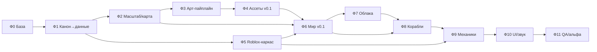

# THREE HORIZONS — ROADMAP 0.1

> **Версия базы:** 0.1 (чистый старт) · **Дата:** 2026-11-10 · **Основа:** только `docs/` (40 файлов канона)
> **Статус:** план. Код, ассеты, тулинг создаются с нуля; старые наработки в `../_TRASH_2026-11-10/` не восстанавливаем.

Этот файл — точка входа. Здесь: как читать роадмап, карта фаз, порядок работ, открытые решения,
гейты качества и грабли, которые уже поймали в прошлой жизни проекта. Детали каждого шага — в
файлах фаз: `docs/roadmap/phase-00-baza.md` … `phase-11-qa-alpha.md`.

---

## 1. Как пользоваться

1. **Перед любой работой** откройте фазу и её шаг. В каждом шаге есть: что сделать, чем, что должно
   получиться и критерий «готово». Пока критерий не выполнен — шаг не закрыт.
2. **Шаг = атомарная единица.** Один шаг — один коммит (или один коммит на 2–3 шага, если они
   мелкие). В сообщении коммита — номер шага: `Ф4.2: базовый набор домов Арквейна`.
3. **После фазы** — прогон гейтов (раздел 5), запись в `docs/CHANGELOG.md`, бэкап, обновление
   `docs/PROJECT_STATUS.md` (переименуем в `STATUS.md` в Ф0).
4. **Канон не правим молча.** Любое отступление от `docs/` — сначала запись в `docs/DECISIONS.md`
   (ID, основание, статус), потом работа. Иначе через месяц снова будет «а как правильно?».
5. **Не строим «всё сразу».** Каждая фаза даёт работающий срез: игру можно запустить и посмотреть.

## 2. Принципы нового старта

- **Сначала данные, потом картинка.** Все правила (фракции, товары, цены, корабли) живут в
  `GAME_DESIGN/` как чистые JSON/Luau-таблицы без Roblox-зависимостей. Roblox — адаптер.
- **Игра не зависит от уровня арта.** Нет меша → фолбэк на боксы (`MeshBuilding` → `Builder`).
  Поэтому геймплей можно проверять, пока художник/пайплайн ещё не готов.
- **Один источник истины на систему.** Масштаб, токены, координаты, цены — по одному файлу.
  Дубли цифр в двух документах = баг документации.
- **Каждый шаг проверяем.** Никаких «сделали, вроде работает»: критерий «готово» — это команда,
  скриншот, цифра из Output или тест.
- **Малые поставки.** v0.1 — это один район одной столицы, один корабль, один товарный цикл и
  один квест. Всё остальное — после того, как это работает.

## 3. Карта фаз

| № | Фаза | Цель | Зависит от | Выход (артефакт) | Сессий |
|---|------|------|-----------|-------------------|--------|
| **Ф0** | [База и правила](docs/roadmap/phase-00-baza.md) | Пустой скелет проекта, инструменты, гейты, версии | — | Репозиторий + `preflight` + структура папок | 1 |
| **Ф1** | [Канон → данные](docs/roadmap/phase-01-canon-to-data.md) | Перевести лор в машиночитаемые таблицы | Ф0 | `GAME_DESIGN/*.json` + валидатор | 2 |
| **Ф2** | [Масштаб и геометрия мира](docs/roadmap/phase-02-world-geometry.md) | Одна система мер, координаты, карта, сжатие | Ф1 | `WORLD_COORDINATES.csv` + карта + решение по масштабу | 1 |
| **Ф3** | [Арт-пайплайн](docs/roadmap/phase-03-art-pipeline.md) | Blender → FBX → Roblox с проверками | Ф0, Ф2 | Скрипты экспорта + валидатор FBX | 2 |
| **Ф4** | [Ассеты v0.1](docs/roadmap/phase-04-assets.md) | 7 типов зданий Арквейна, причал, 1 корабль, 3 материала | Ф3 | FBX + превью + реестр | 3 |
| **Ф5** | [Roblox-каркас](docs/roadmap/phase-05-roblox-skeleton.md) | Rojo-проект, дерево модулей, Config, NetAPI | Ф1 | Собираемый `.rbxlx` + тесты | 2 |
| **Ф6** | [Мир v0.1](docs/roadmap/phase-06-world.md) | Остров + один квартал столицы + вода + спавн | Ф2, Ф4, Ф5 | Плейс со стримингом, 60 FPS в near-зоне | 3 |
| **Ф7** | [Облака v0.1](docs/roadmap/phase-07-clouds.md) | Облачное море, погода, физика поля | Ф6 | Три слоя + CloudField + пресеты | 2 |
| **Ф8** | [Корабли v0.1](docs/roadmap/phase-08-ships.md) | Один корабль: ход, ватерлиния, швартовка | Ф6, Ф7 | Корабль плавает у причала, управляется | 2 |
| **Ф9** | [Механики v0.1](docs/roadmap/phase-09-mechanics.md) | Профиль, деньги, 1 цепочка, 1 NPC, 1 квест, торговля | Ф5, Ф8 | Полный цикл игры на 2 клиентах | 4 |
| **Ф10** | [UI и звук v0.1](docs/roadmap/phase-10-ui-audio.md) | Пак стилей, 4 окна, HUD, звуковой слой | Ф9 | UI-кит + базовые звуки | 2 |
| **Ф11** | [QA, оптимизация, альфа](docs/roadmap/phase-11-qa-alpha.md) | Гейты, бюджеты, закрытая альфа 50–100 | Ф10 | Чек-лист R-1 с evidence + релиз-тег | 2 |

**Итого ~28 сессий** (сессия = один рабочий прогон, 2–4 ч). Фазы 3–4 (арт) и 5 (код) можно вести
параллельно после Ф2: они не пересекаются по файлам.

## 4. Порядок и зависимости

**Критический путь:** **Ф0 → Ф1 → Ф2 → Ф6 → Ф8 → Ф9 → Ф10 → Ф11** (Ф9 дополнительно требует Ф5 —
кодовый каркас, поэтому Ф5 стартует сразу после Ф1, параллельно арт-ветке).
**Арт-ветка** Ф3 → Ф4 идёт параллельно с Ф5 и подключается к Ф6, не блокируя код: если ассетов нет,
мир собирается на боксах-фолбэке.

## 5. Гейты качества (из `docs/QUALITY_ASSURANCE.md`)

| Гейт | Когда | Что проверяем |
|------|-------|---------------|
| **A-1 (арт)** | каждый ассет final/lod | масштаб по спеке, токены DESIGN_TOKENS, имя `TH_*`, LOD, коллизии, бюджет |
| **S-1 (система)** | каждый серверный модуль | юнит-тест, плей-тест 2 клиента + сервер, Remote ≤60/с, сохранения после rejoin |
| **R-1 (этап)** | конец фазы | A-1 + S-1 + CHANGELOG + бэкап + DECISIONS (если меняли лор) |

Правило: **гейт не пройден — фаза не закрыта**, даже если «почти всё работает».

## 6. Открытые решения — принять в Ф0 (иначе цифры разъедутся)

| ID | Вопрос | Что в доках | Рекомендация |
|----|--------|-------------|--------------|
| **S-01** | Метр в studs | `MASTER_SCALE_SPEC`: 1 м = 3 st · `WORLD_SCALE`: 1 м = 3.571 st | **3.571** (физически верно: 1 st = 0.28 м), а «3 st» оставить как бытовое округление в тексте. Записать в DECISIONS. |
| **S-02** | Сжатие мира | `WORLD_MASTER_MAP`: 1:10 · `MASTER_SCALE_SPEC` §5 и `CONTRADICTIONS` P-01: 1:20 | **1:10 по горизонтали и вертикали** — уже посчитаны игровые размеры и карта 18×26 км. 1:20 оставить как аварийный вариант, если упрёмся в лимиты. |
| **S-03** | Размер карты | 54 000 × 78 000 studs (`NEW_MAP_LIVING_SEA`) vs площадь 168 км² в `WORLD_SCALE` | Брать **18×26 км игровых** (WORLD_MASTER_MAP), лор-площадь — только текст. |
| **S-04** | Лимит игроков/шард | P-02: 60–80 | **60** на старте, поднять после профилирования. |
| **S-05** | Вода | Terrain-вода в Roblox падает на 54k×78k вокселей | Вода только в near-зоне (чанки 2–4 км) + туман/облачное море на горизонте. |
| **S-06** | Облака | меш-облака запрещены (D-012) | Три слоя: нативные `Lighting.Clouds` + альфа-клочья + `Atmosphere`. Не тратить время на меши. |

Каждое решение оформляется строкой в `docs/DECISIONS.md` формата:
`| дата | S-0X | решение | основание | APPROVED |`.

## 7. Правила версий и поставки

- Версия проекта — `0.x.y`: `x` — закрытая фаза, `y` — шаг/фикс внутри фазы.
- Каждая фаза заканчивается тегом `v0.N.0` и бэкапом `backups/v0.N_<дата>/`.
- `docs/CHANGELOG.md` — человеческое «что изменилось», один блок на версию.
- `docs/PROJECT_STATUS.md` больше не «живой журнал»: в Ф0 он превращается в короткий `STATUS.md`
  (текущая фаза, шаг, что проверено фактически). История — в CHANGELOG.

## 8. Грабли прошлой жизни (проверено на практике, не повторять)

- **Меш-облака** = «вата»: полигонами не получить просвечивание и мягкий край. Только слои + атмосфера.
- **`AlignPosition` в режиме OneAttachment** держит и XZ → корабль не разгоняется. Для высоты — отдельная
  вертикальная сила с компенсацией гравитации.
- **`Enum.OrientationAlignmentMode`**, а не выдуманный `OrientationConstraintType`.
- **`Enum.Font.Serif` не существует** — валидные с засечками: `Garamond`, `Merriweather`.
- **`StarterPlayerScripts` нельзя репарентать** — LocalScript кладём в существующий сервис.
- **`Clouds` только под `Workspace.Terrain`**, не в `Lighting`.
- **FBX в Studio импортируется руками** (3D Importer) — из Luau нельзя; нужен ручной шаг в пайплайне.
- **EditableMesh на клиенте** — бюджет ~8 мешей; «большой океан» делается патчем вокруг камеры.
- **`Terrain.Size` read-only** (2044×252×2044) — но `FillBall/FillBlock` работают и за пределами Size.
- **Blender на этой машине** запускать с `--threads 2` и `BelowNormal`, иначе CPU 99 %.
- **Python только через `.py`-файл** с `-X utf8`, без inline `-c` со сложными кавычками.
- **Пивот ассетов** — основание по центру; иначе здания «тонут» или висят.
- **Триасы**: MeshPart ≤ 9 500 tri жёстко (Roblox ~10k), hero-бюджет ≤ 12k с авто-тримом.

## 9. Журнал роадмапа

| Дата | Версия | Изменение |
|------|--------|-----------|
| 2026-11-10 | 0.1.0 | Роадмап создан с нуля по чистому канону (после обнуления наработок). 12 фаз, 147 шагов, у каждого — критерий «готово». |

## 10. Файлы роадмапа

| Файл | Содержание |
|------|------------|
| `ROADMAP_0.1.md` | этот индекс |
| `ROADMAP_0.1.canvas` | индекс-канвас: 12 фаз крупными карточками + решения + грабли (пересборка — `python -X utf8 tools/make_roadmap_canvas.py`) |
| `docs/roadmap/canvas/phase-XX.canvas` | канвас на каждую фазу: шаги крупно (620 px), справа Definition of Done, риски, «чего не делаем»; читается при 100 % без зума |
| `ROADMAP_0.1.html` | автономный просмотрщик индекса в браузере без Obsidian; пересборка — `python -X utf8 tools/make_roadmap_html.py` |
| `docs/roadmap/phase-00-baza.md` | скелет, инструменты, preflight, версии |
| `docs/roadmap/phase-01-canon-to-data.md` | перевод лора в данные |
| `docs/roadmap/phase-02-world-geometry.md` | масштаб, координаты, карта |
| `docs/roadmap/phase-03-art-pipeline.md` | Blender-пайплайн |
| `docs/roadmap/phase-04-assets.md` | минимальный ассет-пак |
| `docs/roadmap/phase-05-roblox-skeleton.md` | каркас Roblox-проекта |
| `docs/roadmap/phase-06-world.md` | первый остров и квартал |
| `docs/roadmap/phase-07-clouds.md` | облака и море |
| `docs/roadmap/phase-08-ships.md` | корабль и физика |
| `docs/roadmap/phase-09-mechanics.md` | экономика, NPC, квест |
| `docs/roadmap/phase-10-ui-audio.md` | UI-кит и звук |
| `docs/roadmap/phase-11-qa-alpha.md` | гейты, оптимизация, альфа |
